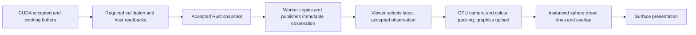

# Live viewer performance

**Retain the indexed sphere mesh.** On the primary RTX 4070 PC, matched hardware
client-window measurements improved physics throughput at 110,592 particles from
0.2863 to 0.3131 simulated seconds per wall second, about **9.4%**. All three large
pairs improved. The rendered hardware images and accepted-state digests matched
exactly. Persistent vertex upload buffers did not justify their cost and were removed.

This does **not** establish 60 FPS desktop presentation or real-time physics at
110,592 particles. WSLg opened the hardware OpenGL window, but desktop visibility
and keyboard focus remained unqualified. The results below measure successful
native client-window presentations, not compositor acknowledgements or scan-out.

## Measurement and complete comparison

The PC used a Ryzen 9 7900X, RTX 4070, WSL2 kernel 6.6.87.2, Windows driver 610.88,
Mesa 25.2.8 D3D12/OpenGL, Rust 1.96.0 and CUDA 13.3.73. Each workload used a real
1280×720 X11 window, CUDA device 0/block 128, the experimental preset, a stationary
fitted camera and unchanged energy colouring. No software renderer, clock override,
driver change or numerical adjustment entered the performance samples.

The experimental values stayed at 240 Hz, eight Jacobi iterations, correction 0.25
and relaxation 20. External benchmark scenes intentionally require the explicit
preset selector; their saved scene configuration otherwise selects reference values.
The worker remains unpaced. Rates above one indicate faster-than-wall-time capacity,
not an enforced 1× playback clock.

There was one warm-up and three alternating pairs per particle count, each computing
1,200 accepted steps, nominally five simulated seconds. Timings below are medians.
The [protocol](/docs/project/development/milestones/05/assets/live-viewer-v1/protocol.md)
retains the original specification and the revision from paused launches to running
launches after focus failures. Every attempt is retained. Build/test/trace work did
not overlap the paired performance samples. Setup and terminal frames are excluded
from running-frame statistics; complete launch-to-completion times are also retained.
The first displayed accepted index varies slightly because worker construction and
stepping begin before graphics construction finishes.

| Particles | Surface presentations/s, before → after | p95 / p99 interval, ms, before → after | Simulated s / wall s, before → after | Physics throughput change |
| --- | ---: | ---: | ---: | ---: |
| 8,000 | 62.738 → 62.738 | 16.481 / 16.586 → 16.682 / 17.070 | 2.2759 → 2.2703 | −0.25% |
| 32,000 | 62.555 → 62.562 | 16.520 / 16.888 → 16.694 / 16.970 | 1.2367 → 1.2597 | +1.87% |
| 110,592 | 62.376 → 62.368 | 17.051 / 17.529 → 17.189 / 17.646 | 0.2863 → 0.3131 | +9.39% |

No measured interval exceeded 33.3 ms in either variant's paired samples. There is
no supported claim that desktop-visible animation is stutter-free. The 16 ms redraw
schedule, plus native redraw events, accounts for the approximately 62.5 Hz client
cadence; it does not set physics timesteps.

Complete-command medians were 2.503 → 2.500 s, 4.277 → 4.214 s and
17.404 → 16.010 s respectively. Large paired complete-command speedups were
1.0905×, 1.0889× and 1.0851×. Small paired simulation ratios were 0.9942×,
1.0158× and 0.9956×: no small-scene gain is established. Tail frame intervals rose
slightly rather than improving. Three pairs describe these workloads on this PC;
they do not establish statistical significance or a cross-platform guarantee.

The [full comparison tables](/docs/project/development/milestones/05/assets/live-viewer-v1/results.md)
include mean frame time, steps/s, CPU stages, utilisation, clocks and host/GPU memory.
Raw CSV, per-invocation summaries and independent summary checks remain in the
[evidence receipt](/docs/project/development/milestones/05/assets/live-viewer-v1/README.md).

## State path and bottleneck

CUDA already retains accepted/working device buffers and static planes. The host
still receives required state and diagnostics at each accepted step. The worker
clones a snapshot and replaces the latest observation; the viewer can coalesce
observations but cannot omit solver work. Rendering and stepping already have
separate threads and cadences. There is no display queue that forces the solver
to wait for each new frame.

The renderer validates identity order, transforms centres in f64 before packing
f32 view-relative centres, computes colours and uploads 16 bytes per particle.
At 110,592 this is 1.77 MB per displayed observation. There is no per-frame particle
sort or fluid-surface reconstruction. The sphere mesh is constructed once, and
particles already use one instanced draw; outlines and the diagnostic overlay add
two draws. Camera conversion, buffer creation and repeated triangle work were
real costs, rather than excessive draw-call count.

| Large workload stage | Before | Indexed |
| --- | ---: | ---: |
| Successful CUDA solver call, CPU wall ms/step | 14.455 | 13.217 |
| Host snapshot copy, CPU wall ms/step | 0.111 | 0.107 |
| Camera/colour/particle preparation, CPU ms/frame | 1.058 | 0.733 |
| Vertex-buffer creation/upload calls, CPU ms/frame | 0.502 | 0.451 |
| Encoding/submission/polling, CPU ms/frame | 0.730 | 0.725 |
| Acquisition, CPU ms/frame | 0.0049 | 0.0050 |
| Presentation call, CPU ms/frame | 8.570 | 7.599 |
| GPU draw interval, ms/frame, separate timestamp profile | 6.829 | 5.961 |

CPU and GPU intervals overlap and must not be added. Presentation and submission
include driver backpressure; they are not exclusive compositor or GPU execution
times. Actual graphics-upload DMA time was not independently resolved. GPU timestamp
builds deliberately synchronise for query readback and are explanatory profiles,
not ordinary FPS/throughput samples. The lower preparation interval is an observation;
the mesh change does not remove that CPU conversion, so it is not presented as an
independent CPU-algorithm improvement.

A separate 240-step large CUDA/GL trace recorded 16,560 launches, 5,040 stream
synchronisations and 1,200 device-to-host copies. CUDA kernels occupied 1.575 s,
about 6.56 ms/step. Device-to-host GPU copies occupied 27.17 ms total, about
0.113 ms/step, carrying 650.29 MB across the prefix. Host-to-device copies occupied
0.108 ms total and carried 2.65 MB, principally initial state. The stream-wait API
occupied 2.314 s and D2H API calls 0.110 s; those include waits and are not extra
costs to add to GPU kernel durations. Transfer bandwidth is not the principal limit.

The large live path is limited by CUDA execution/submission together with graphics
contention on the same GPU. Presentation cadence remains near its timer target.
The matched no-render solver took 7.623 ms/step over the full 1,200 steps, reaching
0.5466 simulated s/wall s within solver calls; its complete CLI took 9.770 s.
Headless controls at 8,000/32,000 took 1.694/2.788 ms/step. These controls test the
new hypothesis of graphics contention and are not a replacement solver campaign.

Removing all graphics would therefore still leave the large case below real time.
Even the early trace's 6.56 ms of CUDA kernel work exceeds the 4.167 ms timestep
budget. The current live path needs approximately 3.19× its accepted-step throughput
to reach real time. Residency alone cannot establish that gain. NVIDIA's version
13.3 WSL guide also lists OpenGL–CUDA interoperability as unsupported; this PC's
usable hardware path is Mesa D3D12/GL and has no NVIDIA Vulkan ICD.<a href="#ref-s043">S043</a>
No interoperability rewrite or repetition of the earlier residency prototype was justified.

## Implementation and retention

The [indexed mesh](/Maelstrom/src/render/gpu.rs) stores 221 normals and 1,152 indices
instead of 1,152 duplicated triangle corners. It preserves the seam/pole floats,
triangle order, winding, shader, camera and colour calculations. An independent
expansion test checks every original coordinate bit. This creates reuse opportunities;
it does not claim a fivefold measured reduction in vertex work. The mesh still
contains 384 triangles per particle, about 42.5 million per large frame.

**Retain:** all three large pairs improved complete performance by about 8.5–9.1%,
with exact hardware images, no numerical change, one small immutable index buffer,
no dependency and no unsafe code. The modest middle-size benefit, small-size
variability and slightly worse frame tails remain part of the decision.

**Do not retain persistent vertex upload buffers:** their large complete-command
ratios were 1.0009×, 0.9979× and 1.0022×, while two small pairs regressed by about
4–7%. Lower allocation/upload-call time did not produce useful end-to-end benefit.
Their patch, exact pixel results and complete campaign remain retained. CPU/GPU
residency, shaders, numerical work and application scheduling were not restructured.

The retained instrumentation exposes cumulative worker solver/copy time and opt-in
frame traces. It adds no GPU waits to ordinary drawing. A final follow-up preserves
existing graphics-error precedence if writing a profile also fails, and corrects the
panel's obsolete claim that solver timing is unmeasured. Those changes received a
separate final-build smoke run at all three counts; they are not pooled into paired medians.

## Capacity, verification and remaining limit

Five-second averages bracketed the real-time boundary between 38,400 and 40,000
particles. Longer observations were necessary: at 38,400 the 20-second median was
0.9623× real time; at 36,800 it was 1.0027× but one run fell to 0.9888× and full
one-second windows fell as low as 0.8906×. There is insufficient headroom there.

**35,200 particles is the highest sustained count verified in this scene family.**
All three runs completed 4,800 timesteps, nominally 20 simulated seconds, with
median advancement 1.0716× and every full one-second window above 1.0388×.
The tested sustained bracket is 35,200–36,800, in increments of one 1,600-particle
lattice layer. This is a measured scene/device/horizon result, not a universal
particle limit or a claim about an unlocked desktop's presentation behaviour.

Twenty-seven hardware images per variant covered all three required counts,
accepted steps 0/240/1,200 and three cameras. All indexed pixels and all compared
position/velocity/identity digests matched the control exactly. The rejected buffer
candidate also matched. All thirteen native files and freshly compiled embedded
PTX agreed across control, indexed, rejected and final executables. Source identities
embedded in the binaries were independently checked. Encoding, hashing, replay,
numerical presets and the ten retained CUDA optimisations remain unchanged.

The PC release suite passed 354 tests with 60 normally ignored hardware/opt-in tests;
explicit runs additionally passed 35 CUDA library tests, 12 viewer-model tests,
10 application lifecycle tests, ten CUDA boundary/execution integration tests and four graphics device tests. Hardware pixel tests,
strict all-target CUDA/viewer Clippy and formatting passed. Local CPU/viewer regressions
passed 352 tests; focused timing/parser/native-focus tests and final lifecycle checks
also passed. The receipt records additional CUDA integration results and original
failed preflights, rather than concealing them.

Native X11 captures verified rendered client pixels at 1280×720 and after resizing
to 1000×680, both paused and running. Running work advanced from step 92 to 422
through capture/resize and both windows closed cooperatively. Model/CUDA tests cover
pause/resume, camera changes, mode selection, restart, scene validation, cancellation,
rollback and teardown. Destroyed-device checks cover detection and retained error
handling. Physical device loss/reset, scan-out and native keyboard/mouse/camera
response remain unverified. Focus queries succeeded after raising the owned window,
but core/XTest/XInput attempts did not reliably reach winit; no desktop was unlocked
or system policy changed to force the journey.

The work remains local and uncommitted. The PC checkout and installed CLI were not
replaced; isolated assessed executables remain in the PC experiment directory named
in the receipt. Neither Git history nor the parent's gitlink was changed.

## References used

-  **S043** — NVIDIA (2026), *CUDA on WSL User Guide*, version 13.3,
  §§5.1–5.2, rechecked 9 November 2026. [Source record](/docs/research/sources/043-nvidia-cuda-on-wsl.md).
