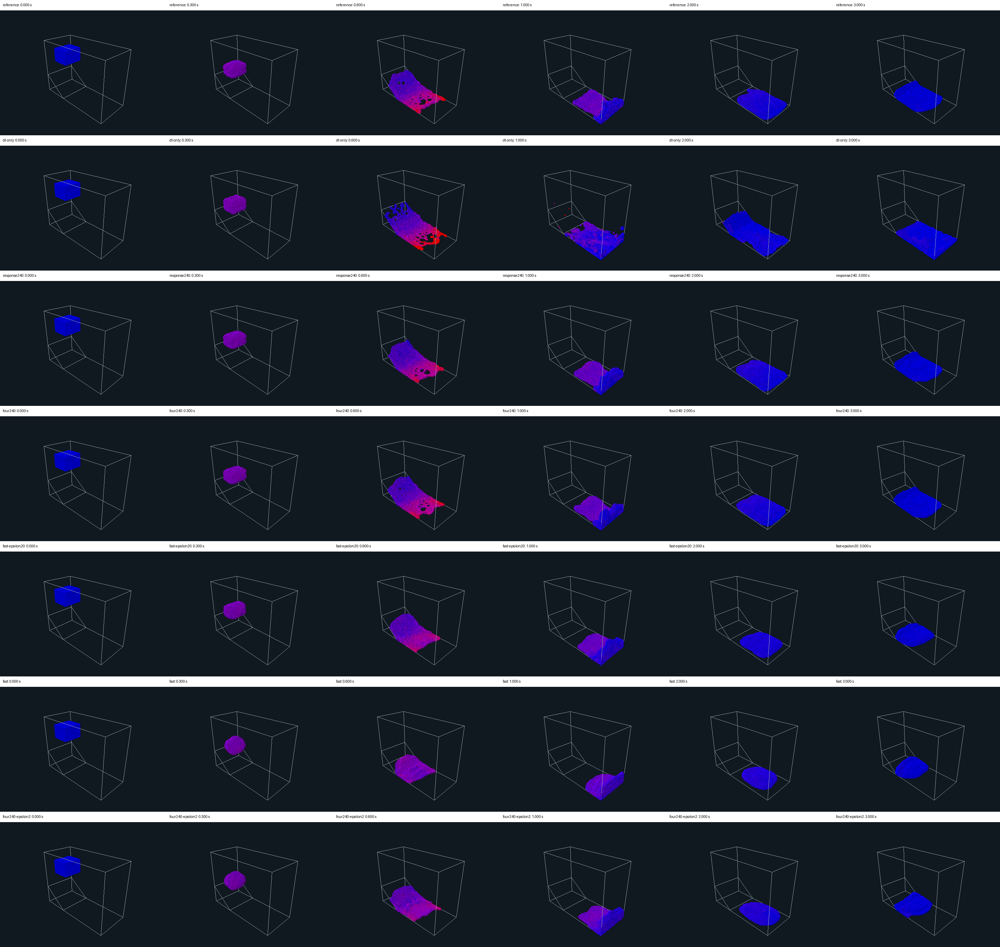
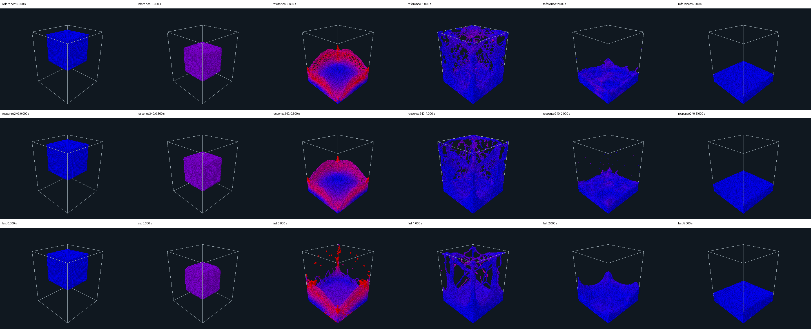

# Reference-like PBF motion with fewer corrections

This revision prioritises the reference mode's visual response over the earlier physical-accuracy
screens. At qualification it retained reference as the application default and preserved fast.
Experimental is now the application default under the [settings contract](/docs/project/development/milestones/05/scene-settings-contract.md). The separate
`experimental` mode selects **240 Hz, eight Jacobi iterations, correction scale 0.25 and relaxation
scale 20**. It keeps the reference artificial pressure, kernels, support, mass and velocity effects.
Explicit overrides still win. The evidence is in [pbf-contract-v1](/docs/project/development/milestones/05/assets/pbf-contract-v1/README.md).

## Numerical audit and revised interpretation

The implementation follows the original PBF loop: acceleration and prediction, one neighbour search,
immutable Jacobi multiplier/correction passes with current distances, plane projection, then velocity
reconstruction from the complete accepted displacement. Poly6 density, substituted Spiky directions,
regularised multipliers and artificial pressure follow the paper's structure. Its typical two to four
iterations are context, not a requirement or a transferable performance result. The paper also
explicitly recognises artificial pressure's timestep and resolution dependence and induced surface
tension.<a href="#ref-s004">S004</a>

There is no missing mass factor or unit conversion in the current equal-mass normalisation. Density
has units m⁻³; constraint directions m⁻¹; their squared sum and regularisation m⁻²; multipliers and
artificial pressure m²; final corrections m. The configuration derives epsilon as `relaxation_scale/h²`
and artificial-pressure strength as `strength_scale*h²`. The latter is a project calibration, not a
universal SI interpretation of the paper's numerical constant.

The unjustified inference was to treat the old refinement recipe as a general convergence law for
incompressible PBF. Multiplying the entire positional correction by dt² changes the effective
finite-iteration material response. It was an empirical stabilisation of the earlier small cases;
neither the paper nor dimensional consistency proves that 480 Hz and eight attenuated passes are
necessary. Conversely, removing that attenuation outright would change the target motion and can
amplify corrections through velocity reconstruction. The existing recipe remains available for old
records; it is explicitly interpreted as response calibration.

For a small, slowly changing correction field, reconstructed velocity gains approximately
`I * alpha * F(x) / dt` per step. Its response per simulated second is therefore approximately
`I * alpha * F(x) / dt²`. This motivates matching `I*alpha/dt²`, while keeping epsilon and artificial
pressure fixed. Reference and experimental both give **115,200 s⁻²**. Experimental halves the step
rate, retains the iteration count, and uses four times the correction per pass. This is a local approximation:
positions, neighbours, collisions and nonlinear iteration errors change. Overrides and enabled
velocity effects fall outside this particular calibration.

Fast instead doubles this response coefficient and reduces epsilon tenfold. At the same geometry,
the density-correction response increases by a factor between two and twenty, depending on the
gradient denominator, while the artificial-pressure response only doubles. Negative density
constraints still attract under-filled surface particles. This changes the balance of contraction,
repulsion and inertial motion; it is not simply a cheaper sampling of reference water.

## Controlled comparisons

The initial seven-case slope-slide matrix changed timestep alone, then correction scale, then count;
separate controls held fast's correction/count fixed while restoring epsilon 20, and held the
four-iteration candidate fixed while reducing epsilon to 2. All used the same 1,680 particles, camera,
gravity, initial bytes and 30 Hz observations for three seconds.

Doubling dt alone produced a more scattered impact sheet. Restoring approximate response with eight
passes at scale 0.25 recovered the reference-like spread. Four passes at scale 0.5 retained that
behaviour. Fast and the low-epsilon four-pass control rounded the falling block and retained a
smaller, more cohesive settled body. Restoring epsilon 20 improved this while keeping fast's other
settings. Thus reduced regularisation contributes directly to the jelly-like response; excessive
total correction response also matters. These observations do not identify a unique elastic modulus.

Two additional controls disabled artificial pressure in the candidate on slope-slide and shallow-tank.
Slope-slide visibly clustered and broke up before impact. Removing artificial pressure is rejected;
the retained mode does not compensate for one visible defect by introducing another.

The initial holdouts ran five seconds with reference, the four-pass candidate and fast: 8,000-particle falling water,
3,456-particle head-on collision, 3,360-particle shallow settling flow, and 110,592-particle impact.
The four-pass candidate retained reference-like block deformation, spreading, wall sheets and tall splash
columns. Fast rounded the free-falling body, produced a different large impact/central jet, and kept
a visibly domed, cohesive shallow body. The four-pass candidate's collision produced less fine spray than
reference; large-impact breakup and individual trajectories differed. Both reference and the candidate
show exaggerated wall sheets in the large impact. These renders alone were insufficient to admit the four-pass option. Its large-scene audit
subsequently found 397 particles with coincident neighbours at peak, versus six for reference. It is rejected.

The bounded follow-up retained eight passes at correction 0.25. This reduced peak particles with coincident
neighbours to seven, close to reference, while preserving the reference response calibration. This
is the selected experimental variant; it is not overlap-free or physically accurate.

The eight-pass variant was then rendered over the same four five-second holdouts. It retained
reference-like spread and settling, with different fine breakup and persistent reference-like wall
sheets. The following comparison shows this final eight-pass mode.

Full animations and contact sheets include the final five-second settling state. Compression,
separation, energy and volume remain separate diagnostics. The independent audit uses current
neighbours in binary64. Large-scene replay samples are admitted only after exact production endpoint
agreement. Sampling cannot exclude every transient near-coincidence, and a falling body's total
energy budget does not independently establish quiet-fluid energy behaviour. No fixed density,
hydrostatic or energy percentage overrules the rendered comparison.

For the **retained eight-pass mode**, sampled p95 positive compression peaks were:

| Scene | Reference | Experimental | Peak particles with coincident neighbours, reference / experimental |
|---|---:|---:|---:|
| Slope-slide | 7.74% | 7.60% | 0 / 0 |
| Falling water, 8,000 | 23.18% | 20.38% | 0 / 0 |
| Collision | 7.63% | 6.38% | 0 / 0 |
| Shallow settling flow | 6.94% | 7.48% | 0 / 0 |
| Large impact | 89.30% | 86.83% | 6 / 7 |

The large compression peak occurs during impact in both modes; settled compression also remains
substantial. Minimum separation is exactly zero in both large trajectories. This option preserves
reference-like motion with a comparable small existing overlap defect; it is **not** qualified for
applications requiring overlap-free particles. The four-pass variant's 397 particles with coincident neighbours are a
new systematic collapse and exclude it despite its attractive timings and images. The concrete
blocker to retaining the fourfold Jacobi-work reduction is dense-impact separation and propagation,
not a chosen physical-accuracy percentage. Exact coincidences have zero Spiky direction, so this
formulation cannot subsequently separate them through that pair's own correction.

## Measurement and implementation

The final RTX 4070 comparison used five simulated seconds, one warmup and five alternating pairs
per size. Ordinary complete solver calls and whole CLI process clocks are reported separately.
Rendering, builds, tests and independent audits were outside admitted timing collection. Compilation
screens are single observations and do not establish live viewer FPS or sustained rendered speedup.

| Particles | Reference solver s/sim s | Experimental solver s/sim s | Solver speedup | Complete CLI speedup |
|---|---:|---:|---:|---:|
| 8,000 | 0.87698 | 0.43509 | **2.016×** | **1.873×** |
| 110,592 | 5.31972 | 2.62717 | **2.025×** | **1.978×** |

These are medians excluding warmup. Paired solver gains ranged **1.990–2.026×** and
**1.985–2.040×** respectively. The candidate achieves about 2.30 simulated seconds per wall second
at 8,000 particles and 0.381 at 110,592: the large case remains below real time. Jacobi passes per
simulated second halve from 3,840 to 1,920; this workload reduction is distinct from measured speed.
The final samples and paired ratios are in `eight-performance-summary.json` in the evidence folder.

The rejected four-pass experiment measured 2.926× and 2.778× solver gains, but its separation defect
prevents retention. Its original `performance-summary.json`, timing samples, renders and audits remain
identifiable. The larger gain cannot be attached to the shipped eight-pass mode.

The implementation adds a named configuration policy through the existing CLI, preferences and viewer
draft. Saved runs retain resolved values. It changes no solver/native arithmetic or safety boundary;
all ten retained CUDA optimisations remain. CLI tests compare the preset against explicit settings
and recorded reruns. CUDA tests exercise every cancellation poll, unchanged accepted state and retry
for the experimental mode. The baseline full all-feature regression and the changed CLI/viewer/CUDA
tests, release build, formatting and strict Clippy are retained with environment details.

The recommendation is to retain the eight-pass option separately and keep reference as default. The calibration
is bounded by the tested scenes, five-second duration and disabled velocity effects. It does not
repair wall-density deficiency, artificial surface tension, material calibration or physical
convergence. No alternative solver or new pressure formulation was investigated. Both Git histories,
the parent gitlink and installed executables were preserved.

## References used

 **S004** — Macklin and Müller (2013), *Position Based Fluids*.
[Source record](/docs/research/sources/004-macklin-muller-position-based-fluids.md).
