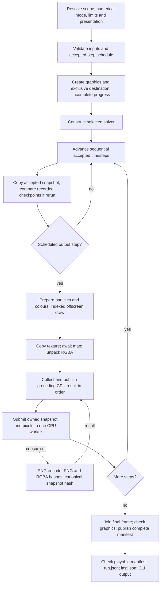

# Simulation cache and independent rendering architecture

**Recommendation: EVOLVE towards a staged particle cache and independent renderer.** Replace the
coupling in which an offline simulation must prepare images as it advances, while keeping the
solver, accepted-state contract, indexed offscreen renderer, bounded PNG encoder, streaming
canonical hashing and exclusive publication. Make simulation results a reusable artefact. Keep
the present `compile` behaviour available until the replacement meets its compatibility and
failure requirements. This review proposes the production design; the isolated experiment is
not an application implementation or a supported cache format.

Reviewed on 10 November 2026. The [implementation sequence](/docs/project/plan.md#proposed-simulation-cache-work)
is proposed work in the owning roadmap. This separately requested review does not reopen numerical
methods or the final cross-backend evaluation. The
[application contract](/docs/project/development/milestones/04/application-contract.md) still owns
accepted observations, cancellation and existing export guarantees. Retention follows the
[assessment policy](/docs/project/development/milestones/05/performance-assessment.md).

## Evidence and source boundary

The local EPQ HEAD was `e7664ee354246507928ac0d80758cffceef0072d`; its recorded Maelstrom gitlink and
Maelstrom HEAD were `6bf2682325b7665e48f8a8647ce087d48ff13f0b`. Both working trees already contained
unrelated work, including an uncommitted CUDA timestep investigation. The audit read those live
files. The PC had the same clean Maelstrom HEAD and a different EPQ HEAD,
`4fb191deddbd70d130c13ffc50a66abf93b6a7e4`. Fresh measurements use an isolated export of that clean
Maelstrom commit plus the retained diagnostic overlay. They do **not** measure the local dirty CUDA
candidate. The evidence receipt records executable, source, shader and PTX identities.

The [experiment receipt](/docs/project/development/milestones/05/assets/cache-architecture-v1/README.md)
separates fresh measurements, historical primary-PC results, calculated storage and unmeasured
production estimates. No production Rust/CUDA file, numerical default, dependency, branch, tag,
gitlink, installed executable, driver or system setting was changed for this review.

## What established systems actually do

### SPlisHSPlasH

Inspected release 2.19.1 at
[`dba6b26b9387ab6bdd187d6df0a7c9d490d03500`](https://github.com/InteractiveComputerGraphics/SPlisHSPlasH/tree/dba6b26b9387ab6bdd187d6df0a7c9d490d03500).
These are implementation findings, not performance comparisons with Maelstrom.

| Responsibility | Actual implementation | Consequence for this design |
| --- | --- | --- |
| Sampling | [`SimulatorBase::step`](https://github.com/InteractiveComputerGraphics/SPlisHSPlasH/blob/dba6b26b9387ab6bdd187d6df0a7c9d490d03500/Simulator/SimulatorBase.cpp#L1625) checks current simulation time against `m_nextFrameTime`, advances that deadline by `1/exportFPS` and invokes exporters; state exports have a separate deadline. | Output frequency is separate from solver timestep. This is threshold sampling, not proof of exact interpolation or timestep alignment. |
| Particle storage | [`ParticleExporter_Partio`](https://github.com/InteractiveComputerGraphics/SPlisHSPlasH/blob/dba6b26b9387ab6bdd187d6df0a7c9d490d03500/Simulator/Exporter/ParticleExporter_Partio.cpp) copies position, integer ID and selected supported attributes into Partio, then writes `.bgeo`. An optional asynchronous task writes/releases the copy; the next write waits for the previous task. | Reusable particles are the simulation product. Bounded asynchronous file work is enough; an unbounded queue is unnecessary. |
| File representation | The bundled [`BGEO.cpp`](https://github.com/InteractiveComputerGraphics/SPlisHSPlasH/blob/dba6b26b9387ab6bdd187d6df0a7c9d490d03500/extern/partio/src/lib/io/BGEO.cpp) writes big-endian BGEO version 5 and optionally gzip. The exporter requests compression. [`ParticleExporter_VTK`](https://github.com/InteractiveComputerGraphics/SPlisHSPlasH/blob/dba6b26b9387ab6bdd187d6df0a7c9d490d03500/Simulator/Exporter/ParticleExporter_VTK.cpp) writes binary legacy VTK unstructured grids with vertex cells, IDs and selected attributes. | “Partio” is a library/API, not one standard cache format. BGEO generations and integer widths need explicit compatibility checks. |
| Restart | [`saveState` / `loadState`](https://github.com/InteractiveComputerGraphics/SPlisHSPlasH/blob/dba6b26b9387ab6bdd187d6df0a7c9d490d03500/Simulator/SimulatorBase.cpp#L1731) save scheduling counters, parameter state, time-manager and simulator state alongside particle/boundary files. Load compares a scene-file MD5 and warns on mismatch. | A particle sequence is different from restart state. Scene-name/path identity alone is insufficient reproducibility evidence. |
| Rendering | [`PartioViewer`](https://github.com/InteractiveComputerGraphics/SPlisHSPlasH/blob/dba6b26b9387ab6bdd187d6df0a7c9d490d03500/Tools/PartioViewer/PartioViewer.cpp#L675) loads the recorded sequence and generates JPEG images, or pipes rendered RGB frames to ffmpeg. Camera, dimensions, colour field, range and playback FPS are viewer options. Its inspected generation loops render/read back frames sequentially; `--noOverwrite` skips existing images. | Independent rendering is valuable even with one graphics owner and serial GPU submission. Independence does not imply parallel GPU frame execution. |

The [viewer documentation](https://github.com/InteractiveComputerGraphics/SPlisHSPlasH/blob/dba6b26b9387ab6bdd187d6df0a7c9d490d03500/doc/PartioViewer.md)
and source agree on saved-sequence rendering and ffmpeg. The inspected export paths do not establish
Maelstrom-style cryptographic manifests, transactional whole-sequence publication or crash durability.
Maelstrom should preserve its stronger provenance policy, rather than copy unchecked file-skipping
or shell-built ffmpeg commands. No upstream simulator/viewer was executed here.<sup><a href="#ref-s060">S060</a></sup>

### Houdini and Blender/Mantaflow

Houdini's official File Cache documentation distinguishes simulation frames that depend on earlier
frames from independent geometry cooks that can run in parallel. It writes reusable geometry,
normally versioned `.bgeo.sc`, and switches to loading it from disk. Its dynamics documentation
separates that geometry from `.sim` checkpoints, with explicit intervals and checkpoint trails.
USD Render documents an external rendering process. These are vendor-documented behaviours;
Houdini's proprietary implementation, automatic invalidation internals and throughput were not
inspected. The useful pattern is a durable intermediate result, not adopting Houdini's dependency
graph or USD machinery.<sup><a href="#ref-s082">S082</a></sup>

Houdini's dynamics documentation also distinguishes invalidated temporary disk cache files, which
can be deleted automatically, from explicit checkpoints retained at chosen locations. That is a
useful recovery distinction; Maelstrom should use immutable cache versions rather than copy an
automatic deletion policy for expensive user-selected results.<sup><a href="#ref-s082">S082</a></sup>

Blender 4.5.0's pinned
[`fluid.cc`](https://github.com/blender/blender/blob/8cb6b388974a817afedf1317ce26f0c75aa5f181/source/blender/blenkernel/intern/fluid.cc#L3742)
distinguishes modular/all/replay paths and reads data, mesh and particle caches separately.
Mantaflow's
[`liquid_script.h`](https://github.com/blender/blender/blob/8cb6b388974a817afedf1317ce26f0c75aa5f181/intern/mantaflow/intern/strings/liquid_script.h#L454)
selects final fields or final plus resume fields according to `resumable`. Its
[`fluid_file_export`](https://github.com/blender/blender/blob/8cb6b388974a817afedf1317ce26f0c75aa5f181/intern/mantaflow/intern/strings/fluid_script.h#L680)
normally skips intermediate subframes, dispatches combined VDB/mesh writes and falls back to
per-object writes. This is source evidence for separate output products and additional restart
data. The Python templates also catch and log some I/O exceptions: that failure policy should
not replace Maelstrom's explicit failed outcomes. Blender was not run; the manual fetch failed,
so detailed claims here rest on pinned code.<sup><a href="#ref-s083">S083</a></sup>

The same Blender modifier code resets an outdated Replay cache at the start frame. Modular/All
paths load completed bakes; paused bake counters select the preceding frame when resuming, and
derived products are clamped to the available data frame. This establishes explicit bake-state
handling, not transactional filesystem recovery or a general cryptographic cache identity.
Maelstrom's own input/result fingerprints and incomplete-prefix contract remain necessary.<sup><a href="#ref-s083">S083</a></sup>

Across these sources, caching supports changing presentation after simulation. None establishes
automatic pixel determinism across drivers, a particular cache compression ratio, or faster
first export on Maelstrom's GPU. Maelstrom should make those separate claims with separate evidence.

## Current `maelstrom compile` execution path

The following map refers to the live source; the measured committed implementation has the same
export/render/encoding responsibilities. The important ordering is visible in
[`cli/bundle.rs`](/Maelstrom/src/cli/bundle.rs),
[`export/mod.rs`](/Maelstrom/src/export/mod.rs),
[`offscreen.rs`](/Maelstrom/src/export/offscreen.rs) and
[`encoding.rs`](/Maelstrom/src/export/encoding.rs).



1. The CLI resolves package/default configuration, explicit overrides, numerical mode and execution
   selection, then steps/duration and presentation settings. `FrameSchedule` selects
   `0,K,2K,... <= S`, appending `S` when needed; zero steps produces one frame. It rejects zero
   stride, overflow and more than one million frames. Nominal five seconds at 240 Hz/stride 4
   means 1,200 solver steps and **301 observations**, including both endpoints.
2. Export validates settings, timestamps and recorded observations before output creation. It uses
   a serial simulation to validate/reconstruct initial inputs without acquiring CUDA/thread-pool
   resources, captures `RecordedInput`, builds boundary display lines and resolves a fitted camera
   once. Graphics setup precedes exclusive destination creation and incomplete `progress.json`.
3. Direct compilation constructs the requested solver. Every timestep completes acceptance before
   the next one begins. [`Simulation`](/Maelstrom/src/simulation/mod.rs) owns rollback/commit.
   [`CudaSolver::step`](/Maelstrom/src/cuda/solver.rs) retains accepted device vectors, performs
   validation/cancellation polls and downloads candidate positions/velocities and diagnostics to
   build an accepted host state. These solver readbacks happen independently of PNG sampling;
   writing one cache frame per four steps does **not** remove three quarters of solver transfers.
4. The export loop currently creates a `SnapshotRecord` at **every accepted boundary**, even when
   unscheduled. Rerun comparison may require additional stored checkpoint indices. For ordinary
   direct capture, copying every unscheduled snapshot is an application choice. Moving this copy
   to required observation indices is possible later, without changing timestep acceptance.
5. Scheduled output converts records to particles, validates ascending identities, computes colours
   and view-relative centres and uploads 16 bytes per particle. Offscreen graphics remain indexed
   spheres: the live viewer's analytic impostor selection does not change this path. It allocates
   colour/depth/readback resources, draws, copies the texture to a row-aligned map buffer, polls
   until completion and strips row padding. A CPU encoder necessarily needs completed pixel bytes.
6. `queue_frame` prepares the current image while the previous image encodes, collects/publishes
   the previous result, then submits the current job. The first frame is collected immediately.
   One worker owns an immutable snapshot and RGBA; channels/pending state admit one job/result,
   with at most one further prepared frame. PNG compression/filtering and pixel origin are fixed.
7. The worker computes encoded-PNG and decoded-RGBA SHA-256 and the **unchanged canonical snapshot
   JSON digest**, including velocities. [`snapshot_json.rs`](/Maelstrom/src/workflow/snapshot_json.rs)
   emits the exact pretty JSON byte stream through a 64 KiB buffer into SHA-256; it does not
   materialise the full JSON. The generic standalone serializer remains the independent byte oracle.
8. Publication stays on the calling thread. [`publish_bytes`](/Maelstrom/src/workflow/output.rs)
   writes an exclusive sibling staging file, syncs it and hard-links it to a non-existing final
   name; RAII removes staging files. Progress is replaced through a temporary file. There is no
   directory fsync, so this is not a qualified power-loss durability guarantee. Errors retain the
   published prefix; worker drop closes and joins pending CPU work. Cancellation stops between
   solver stages/whole synchronous frames and does not publish an outstanding worker result.
9. Only after draining all frames, checking cancellation/graphics and closing the schedule does
   export publish `manifest.json`. It embeds resolved initial inputs, accepted diagnostics,
   numerical/device/build/render/encoder provenance, step/time mappings and the three frame hashes.
   It **does not store the sampled particles**. The CLI then checks playability, publishes catalogue
   metadata and updates `last.json`; a later catalogue failure can leave a completed image manifest
   despite an overall CLI failure. Timings inside the manifest end before its own publication;
   complete process timing includes the remaining work and teardown.

Existing facilities already distinguish saved data from reruns:

| Facility | What it really does | Reuse |
| --- | --- | --- |
| `export saved` | Parses stored result/checkpoint snapshots, validates coverage, renders without constructing the recorded CUDA/threaded backend. It materialises JSON and a `BTreeMap` of snapshots. | Validation semantics and source-to-render boundary; replace whole-history JSON loading with indexed frame reads. |
| `export rerun` | Recreates recorded inputs and checks saved checkpoints; serial compares exact bits, CUDA/threaded use existing tolerances. | Migration and regenerated-cache verification. Never call it continuation. |
| `replay` | Reruns recorded inputs from zero. | Input compatibility; not cache playback or a checkpoint loader. |
| `play` / `Sequence` | Displays saved PNGs. It verifies encoded bytes and decoded RGBA when decoding. | Existing image bundles remain independently playable after cache deletion. A snapshot hash alone cannot recover or independently revalidate absent particle state. |
| `Controller` observations | Latest immutable accepted observation may coalesce for the live viewer. | Keep for live viewing. An offline cache needs a lossless scheduled sink, not the coalescing display channel. |

### Necessary and unnecessary dependencies

| Ordering | Necessary? | Proposed treatment |
| --- | --- | --- |
| Accepted timestep `n` before timestep `n+1` | Yes, for this solver contract. | Preserve solver ownership and all acceptance/rollback checks. |
| Capture scheduled state before solver overwrites it | Yes. | Transfer ownership of a bounded immutable copy to the cache writer. |
| Frame pixels before encoding those pixels | Yes. | Preserve readback completion and GPU-resource lifetimes. |
| Render frame `i` before simulating later steps | No. | Remove through the cache boundary. |
| Encode frame `i` before rendering `i+1` | No; already partly removed. | Retain the worker; consider a small resource ring only after measurement. |
| Render frame `i` before rendering `i+1` | No state dependency in the current renderer. | Frames can be requested in any order. One GPU owner may still submit serially for efficiency. |
| Publish frames/manifests in deterministic order | Required observable policy, not a rendering dependency. | Index tasks; bound outstanding results; commit a contiguous ordered prefix. |
| Compute canonical provenance anew for every camera | No, after validating exact state and a bound digest. | Compute once during caching; preserve the same canonical JSON hash meaning. |

## Compare the three architectures

| Property | A: current streaming compile | B: simulate/cache, then render | C: bounded cache producer and render consumer |
| --- | --- | --- | --- |
| First-export work | No particle-disk pass; solver and graphics interleave; CPU output overlaps. | Adds writes/reads and phase startup; avoids simultaneous solver/graphics use. Can be slower. | Can overlap work, but retains disk I/O and same-device contention. |
| Repeat camera/colour/resolution export | Simulation again unless a separate complete observation result was saved. | Read cache and render only. | Same reuse as B once cache exists. |
| GPU | One caller interleaves CUDA and graphics; CPU gaps/backpressure affect cadence. | CUDA owns the GPU during bake; graphics owns it during render. | Separate threads/processes do not create extra GPU capacity. Same-GPU contexts compete. |
| CPU | One encoder/hash worker plus caller. | Bounded cache packing/hash work; later decode/upload and existing encoder. Can reuse validated canonical digests. | Cache, graphics and encoding workers compete for CPU and memory bandwidth. |
| Memory | Bounded snapshots/images, solver and graphics coexist. | Bounded frames; solver and graphics need not coexist. Do not load 301 frames into RAM. | Solver, graphics and several queued states/pixels coexist; bounds are essential. |
| Disk | PNGs, manifests and inputs. | Binary state sequence plus PNGs/manifests; independent render failure leaves simulation intact. | Same total storage, concurrent I/O and more partial states to track. |
| Reliability | A late graphics/output failure loses the unrecorded simulation trajectory. | Completed cache survives render failure; independent retries and selected-frame rendering. | Cache completion and rendering completion must remain distinct; renderer failure should not cancel a successful bake. |
| Complexity | Lowest existing cost. | Small explicit stage boundary and reader/writer; simplest reusable design. | Additional scheduling, backpressure and cross-stage cancellation policy. |

**Choose B by default on the single RTX 4070.** The
[live-renderer comparison](/docs/project/development/milestones/05/performance-particle-rendering.md)
measured large-scene solver-call time changing from 13.361 to 8.732 ms/step as graphics cost fell,
with unchanged numerical work. Earlier
[compilation profiles](/docs/project/development/milestones/05/performance-render-pipeline.md)
also show cadence and clock interactions. This is evidence that GPU contention matters; it is not
a measurement of a new hybrid cache implementation. C remains an explicit future option for a
second GPU, cheap previews, or measured first-export gains. A cache-writing CPU worker may overlap
CUDA in B; that does not make simulation and graphics concurrent.

## Proposed internal cache contract

### Data and separation of responsibilities

Use a directory of independently readable, uncompressed binary particle frames with a small
versioned manifest and frame receipts. Fixed particle population and ascending stable identities
match the current solver. Store identity once, rather than repeating it in every frame.

| Data | Owner and representation |
| --- | --- |
| Positions and velocities | Required per selected frame: exact original IEEE-754 f32 XYZ positions in metres and XYZ velocities in m/s. No quantisation, float-to-half conversion, coordinate rebasing or sorting. Two contiguous attribute arrays, 24 bytes/particle. |
| Identity | Required immutable ascending u64 table, checked against resolved initial input. Frame row `i` always refers to table row `i`. Dynamic births/deaths require a future schema, not silent identity reuse. |
| Time | Required frame index and exact accepted timestep index as u64; JSON uses canonical decimal strings. Store the exact f32 timestep bits. Derive current-compatible simulated seconds as `f64(step) * f64(dt_f32)`; retain an optional nominal output-rate rational and the actual schedule. |
| Physical geometry and scaling | Cache manifest: immutable resolved initial input, planes, coordinate convention, spacing/radius convention, particle mass, effects, numerical configuration, comparison key, diagnostics and build/device provenance. Static display bounds derive from the same initial geometry. |
| Presentation | Render manifest: camera, fit policy and resolved camera, width/height, colour mode/range, renderer/shaders, graphics identity and encoder settings. A suggested initial view may be optional metadata, excluded from simulation identity. |
| Diagnostics | Retain every accepted step's existing diagnostics, independently of the sparse particle-frame schedule. No reduction of validation or accepted-history guarantees. |

Exact positions, velocities and identities plus mass/spacing, boundary geometry and render settings
are sufficient for the current deterministic visual replay on a matching graphics stack. Velocities
are needed for energy colouring and the existing canonical digest. IDs alone with positions are
insufficient for all current modes. No density, neighbour rows, lambdas, tentative buffers or CUDA
pointers are required by this renderer. Cache additional attributes only when a real consumer needs
them; unavailable future colour fields must fail explicitly. Matching particle bits does not imply
cross-GPU/driver pixel equality.

This is a **render observation cache, never a full solver checkpoint**. Even if a future PBF restart
could reconstruct much of its scratch state from positions/velocities, it needs its own restore API,
validation, numerical equivalence and failure qualification. No cache command promises continuation
from a cached frame.

### Layout, indexing and validation

Recommended v1 has `cache.json`, an immutable `input.json`, `identities.bin`, deterministic
`frames/frame-00000000.mpc` names and per-frame receipt files. A JSON index contains only metadata,
not particle arrays. Readers open an exact indexed file; memory scales with a few frames.

Specify little-endian fields explicitly, never dump a Rust/C struct. One possible **128-byte** raw
frame header is: magic[8], major u16, minor u16, header length u32; then frame index, accepted step,
particle count, raw byte length, stored byte length, position offset and velocity offset (seven u64);
codec u32, flags u32, simulation-request fingerprint[32], reserved[16]. Offsets are relative to the
file start; raw v1 arrays start at 128 and `128 + 12*N`. All reserved bits/bytes are zero. The receipt
stores the full-file SHA-256, byte length, accepted step and unchanged canonical snapshot SHA-256.
This is a design proposal, distinct from the experiment's deliberately smaller 24-byte header.

Readers enforce magic/version/codec, configured particle/frame limits, finite values, ascending
identity table, checked multiplication/offsets, exact lengths, no overlapping arrays and consistency
with the requested schedule/input fingerprint. They reject path traversal, symlink substitution and
unexpected extra data; filenames are derived from integer indices. Open and validate the same file
handle used for consumption. Bound decompressed size before allocation if compression is later added.

Raw layout permits seeking straight to one frame and reading positions without velocities for
appropriate consumers. Full canonical validation still needs both arrays and identities. Initially
verify the complete selected frame's checksum before rendering, even when a consumer only uses one
attribute. Checksums establish integrity relative to the manifest; they are not signatures or proof
of physically correct simulation.

Compute `snapshot_sha256` through the retained canonical writer while the cache is produced.
Keep binary checksums separate: **a binary-file hash never replaces the canonical JSON hash**.
A full cache validation reconstructs snapshots and recomputes canonical hashes. During ordinary
repeat rendering, a validated frame descriptor may carry its established canonical hash through
the CPU worker after checking the bound binary bytes. This avoids reformatting unchanged particles
for every camera. Such a shortcut needs typed ownership and corruption tests before adoption;
the conservative prototype deliberately rehashes during rendering.

### Publication, interruption and invalidation

The writer exclusively creates a new cache directory. It writes/syncs immutable inputs first,
then stages each frame, syncs its bytes and exclusively publishes it. After that it publishes the
frame receipt; only receipt-backed frames are committed observations. A complete manifest is
published last, after the exact schedule and all diagnostics close. Do not make directory existence
or the last numbered file imply success. Use directory fsync where the platform supports it if
power-loss durability is promised; qualify this separately from current process-failure semantics.
Commit the initial observation before advancing, preserving the current initial-output barrier.
Progress distinguishes accepted solver steps from durably committed cache frames; neither count
may stand in for the other after an I/O failure. Cooperative cancellation closes/joins owned work
without publishing an outstanding result, while retaining the already committed prefix.

An interrupted writer leaves an explicit incomplete prefix. Inspection verifies receipts, frame
lengths/checksums and input binding. Ignore orphaned frame/staging files without receipts; do not
adopt them from a recomputed checksum with no original integrity reference. Permit rendering an
explicit available range under `--allow-partial`, with its own incomplete-source provenance.
Never claim an incomplete prefix is the requested complete simulation. Rendering can restart from
verified output receipts and skip completed frames; simulation continuation remains unavailable
without a separate qualified solver checkpoint. A bake restart otherwise runs from zero and can
compare/verify a prior prefix under an explicit regeneration operation.

The request fingerprint includes fully resolved physical inputs, numerical/effect configuration,
solver implementation/build identity, execution policy, exact timestep, total accepted steps and
sampling schedule. Keep metadata labels separate from the physical comparison key. Final cache
identity additionally binds ordered frame digests and accepted diagnostics: equal requests need
not imply bit-identical results across GPU stacks. Camera, dimensions and colours belong to a
separate render key. A changed simulation request creates a new version/path; it does not delete or
silently reinterpret a historical cache. A renderer upgrade may re-render an old compatible cache
without claiming that it reproduces the old images.

Major versions reject incompatible layouts; minor versions may add explicitly optional metadata.
Required unknown features/codecs fail. An offline conversion tool, not runtime guessing, handles
future migration. Avoid automatic cache discovery by scene name alone.

### Formats and storage trade-offs

| Format | Assessment for this workload |
| --- | --- |
| Compact binary plus JSON metadata | Recommended internal format: f32/u64 fidelity, small Rust-only implementation, direct frame access and explicit provenance. Costs a format specification and corruption tests. |
| Partio/BGEO | Good optional interoperability. Partio is C++ and supports multiple particle formats; the inspected SPlisHSPlasH path uses older BGEO v5 and 32-bit integer attributes. Do not narrow Maelstrom u64 IDs silently, assume modern `.bgeo.sc` equivalence or require a native I/O dependency for every render.<sup><a href="#ref-s060">S060</a>, <a href="#ref-s084">S084</a></sup> |
| VTK | Useful first external adapter for particle analysis, with an explicit 64-bit identity representation and round-trip tests. Legacy vertex-cell records add metadata/bytes; XML VTK could be a later maintained adapter. No need to make either the internal archive. |
| OpenVDB | Its sparse grid/tree/transform model suits volume products. Point storage also exists, so it is not categorically incapable of this task; adopting its machinery for two fixed arrays lacks a current measured benefit. Reserve it for a concrete external/volume consumer.<sup><a href="#ref-s085">S085</a></sup> |
| Pretty snapshot JSON | Preserve existing saved-input compatibility and canonical hashing. Avoid as the bulk cache: many bytes, parse/allocation overhead and awkward partial access. |
| Alembic/USD/general scene archives | Potential external publishing formats, with substantial schema/dependency scope. A particle-frame reader boundary leaves room for them without implementing them now. |

Start uncompressed. Optionally evaluate lossless low-level zstd per frame or attribute block after
raw I/O is measured; record codec/version and bound output sizes. Do not use a single compressed
stream across all frames, lossy packing or delta chains. Those complicate seeking and recovery.
No compression ratio or codec speedup is claimed by this review.

For **301 frames**, raw particle payload is `301 * 24 * N`; static u64 IDs add `8*N` once.

| Particles | Payload/frame | 301-frame payload | Payload + IDs + 128-byte headers | Continuous 60-frame/s payload rate |
| ---: | ---: | ---: | ---: | ---: |
| 8,000 | 192,000 B (0.183 MiB) | 57,792,000 B | 57,894,528 B (55.21 MiB) | 11.52 MB/s |
| 110,592 | 2,654,208 B (2.531 MiB) | 798,916,608 B | 799,839,872 B (762.79 MiB) | 159.25 MB/s |

These exclude one-time resolved initial-input JSON, receipts, diagnostics, filesystem allocation and
images. The particle population in `input.json` may itself occupy tens of MB at the larger count;
keep it once and measure its cost. Caching all 1,201 accepted boundaries instead would take about
3.19 GB of large raw particle data, nearly four times the required output cache. At faster-than-real-time
bake speed, required write rate is total bytes divided by actual bake wall time, not the nominal
60-frame/s rate. Retaining ten large five-second caches consumes about 8 GB of particle payload.

## Independent renderer and export workflow

Create a validated frame-source boundary whose real implementations are the existing saved-result
reader and the binary cache reader. It supplies immutable frame data, step/time, identities, physical
display context and a bound canonical digest. The render service must not own a `Simulation`, load a
CUDA context, infer missing states or resolve mutable scene files. Split common observation scheduling
from optional `render` features so a cache bake works in a headless/CUDA build without wgpu.

Keep one graphics owner on this PC, persistent scene context and the current indexed offscreen
pipeline. Reuse the bounded encoder and exact PNG settings. A later two/three-slot texture/readback
ring can overlap graphics submission, mapping and CPU output if a matched benchmark warrants it.
Multiple CPU encoder threads may help larger images; multiple GPU-owning workers are a different
experiment and can increase contention and device memory without increasing throughput. Bound all
queues in bytes as well as frame count, including pending RGBA and encoded outputs.

Frame tasks may be requested by index/range or independent render jobs. Preserve stable particle draw
order and assign every result its original frame index. A small reorder buffer can commit the
contiguous prefix; final manifests contain the deterministic requested sequence, independent of
completion order. Re-rendering must use explicit settings and record the resolved camera, including
whether it was re-fitted at a new aspect ratio.

Proposed commands below are **design examples, not commands implemented by this review**:

```sh
# New simulation; caches selected accepted states, with no graphics work.
maelstrom cache bake builtin:large-impact --duration 5 --frame-stride 4 --backend cuda -o caches/impact

# Existing particle observations; no fluid steps. Repeat with new presentation files.
maelstrom render caches/impact --render-config cameras/front.toml --width 1280 --height 720 -o renders/front
maelstrom render caches/impact --render-config cameras/side.toml --width 1920 --height 1080 -o renders/side
maelstrom render caches/impact --frame 150 -o renders/still
maelstrom cache validate caches/impact --full

# Existing PNGs, preserving the current play semantics.
maelstrom play renders/front

# Later adapters; neither needs fluid steps.
maelstrom export particles caches/impact --format vtk -o interchange/impact
maelstrom export video renders/front --fps 60 -o front.mp4
```

Keep `experimental` as the existing application default and all selectors/overrides intact. Saved
reruns use recorded resolved numerics, not today's preset. `--fps 60` may eventually resolve an
explicit sampling policy; v1 should use the existing exact step stride. A non-integral relation
between solver timestep and requested output time must be rejected or use an explicitly documented
accepted-step selection policy, never hidden interpolation. A 60 Hz cache cannot later supply new
true 120 Hz states. Lower-rate subsets are possible; interpolation would be a separate visual mode.

Image sequences remain the durable default. Optional direct video can stream ordered RGBA to an
explicitly discovered ffmpeg subprocess with argument arrays, bounded backpressure, stderr capture,
exit-status checks and temporary-to-final publication. Avoid a shell and implicit encoder installation.
CPU video encoding should be the first option; hardware encoding and GPU contention require their
own measurements. A video-only output has its own manifest and cannot pretend to be a schema-1 PNG
bundle with nonexistent PNG hashes. Record codec, pixel format, rate, colour conversion and encoder
identity. Lossy/YUV conversion is an explicit image-quality choice.

The 301 samples include times zero and nominal five seconds. Encoding all 301 at constant 60 FPS
produces 301/60 = 5.0167 seconds of display duration. A five-second video needs an explicit terminal
sample policy or timestamp-based durations. Preserve the 301-frame image schedule; do not silently
drop its endpoint or confuse simulation time with playback FPS.

The same frame source can later feed surface reconstruction or an external renderer. Neither
surface generation, foam nor a new shading model is part of this implementation plan.

## Empirical comparison and performance model

### Fresh primary-PC experiment

The isolated [Rust probe](/tools/performance/cache_review_probe.rs) adds a checked snapshot
constructor and access beside the existing private exporter in a temporary source export. It uses
the production solver, indexed offscreen path, bounded encoder, canonical hash writer and file
publisher. No cache logic is installed in the application. The
[collector](/tools/performance/cache_review.py) ran one warm-up and three alternating A/B pairs per
particle count. Each request computes 1,200 steps with experimental numerics, device 0/block 128,
stride 4, 301 frames at 640×480. B also renders the cache at 1280×720 using the original resolved
camera. Separate simulation-only invocations provide a complete-process control. All run in release
with the locked dependencies on the Ryzen 9 7900X/RTX 4070, WSL2, driver 610.88, Rust 1.96.0 and
CUDA 13.3.73; graphics are hardware OpenGL through Mesa D3D12.

The probe stores six exact f32 components and a 24-byte header per frame, with identities supplied
by its immutable resolved-input request. It serially calculates canonical and binary hashes and
syncs every frame. Rendering checks binary bytes, reconstructs validated snapshots and **recomputes
canonical hashes** through the unchanged encoder worker. Its index is published after completion;
it does not implement the proposed receipt journal, self-contained cache directory, digest reuse,
bounded asynchronous cache writer or production cache CLI. A's boundary is complete `compile`,
including catalogue/CLI/teardown. B's first-export boundary is the sum of its two complete processes,
using a frozen resolved-input request rather than normal CLI scene resolution. B outputs probe
records, not supported application bundles. Treat it as an isolated architecture comparison.

The table gives **median process wall seconds [full measured range]**, excluding warm-ups. OS page
cache was warm; there was no cache-flush or disk-policy change. Stage totals below are diagnostic and
overlap where stated. Earlier performance campaigns are not pooled with these samples.

| Operation for five nominal simulated seconds | 8,000 particles | 110,592 particles |
| --- | ---: | ---: |
| Simulation only, complete process | 2.606 [2.598–2.628] | 14.641 [14.544–14.685] |
| A: first complete 301-PNG compile | 6.298 [6.132–7.449] | 20.439 [19.647–21.187] |
| B: bake particle cache | 4.992 [4.260–5.012] | 23.901 [23.798–23.940] |
| B: render cache at 640×480 | 6.602 [5.850–6.796] | 11.866 [11.796–11.923] |
| B: first bake + 640×480 export, median of paired sums | 11.614 [10.110–11.788] | 35.767 [35.594–35.863] |
| B: re-render cache at 1280×720 | 10.429 [9.562–10.819] | 15.953 [15.892–16.752] |

The prototype's first export is **84.4% slower at 8,000** and **75.0% slower at 110,592** than A by
median ratio. At the large count, another same-resolution cache render takes about 58.1% of a fresh
compile's time; the small cached render is slightly slower than compiling again. Do not describe
caching as a universal speedup. Using these medians unchanged, the conservative large prototype
breaks even at about 2.79 same-resolution presentations, so three presentations; the small measured
case has no same-resolution timing break-even. This is a workload model, not a repeated-render
campaign or a forecast for a new camera's image complexity.

Supplementary new-resolution controls explicitly fixed A to the same resolved camera as B. One
additional invocation per count took **9.123 / 20.729 s** for fresh 1280×720 compilation. All 602
corresponding PNG/pixel/snapshot records matched the cache renders exactly. These controls are
single supplementary observations, collected later; do not turn their ratios against B's medians
into a paired speedup claim. The initial campaign's A alternative-resolution commands instead
re-fitted their cameras; those records are retained but not used for matched pixel comparisons.

The [post-run checks](/tools/performance/cache_review_checks.py) additionally changed camera and
colouring and rendered 301 frames per count with `CUDA_VISIBLE_DEVICES` empty in that process:
images changed while all snapshot digests stayed unchanged. Cache rendering executed no fluid
steps and did not need a CUDA solver context. Across warm-up and measured same-camera runs, all
**2,408 frames** agreed on encoded PNG, RGBA and canonical snapshot digests, and all accepted
diagnostics agreed between streaming and bake. Independent checks hashed **4,816 published probe
PNGs**, fully decoded/validated eight original application bundles and recomputed canonical hashes
for 602 cached states. These observations establish replay fidelity on this stack, not cross-driver
pixel equality or physical accuracy.

### Costs, utilisation and memory

| Median diagnostic seconds, all 301 frames | 8,000 | 110,592 |
| --- | ---: | ---: |
| B bake: solver calls | 2.513 | 13.988 |
| B bake: canonical hashing, serial in this prototype | 0.486 | 6.539 |
| B bake: packing, binary hash, writing and per-frame sync | 1.647 | 2.446 |
| B render: read, decode and binary/state validation | 0.090 | 0.995 |
| B render: graphics + readback, CPU wall | 1.376 | 5.600 |
| B render: PNG encoding on worker | 3.016 | 2.889 |
| B render: canonical + image hashes on worker | 0.629 | 6.730 |
| B render: remaining caller wait for output worker | 2.219 | 2.955 |

Worker intervals overlap graphics, reads and caller work. In particular, eliminating 6.73 s of
worker hashing would not subtract 6.73 s from large elapsed render time. The isolated render's
graphics/readback is also slower than the roughly 2.9 s interleaved A stage in these samples.
GPU cadence/clocks and CPU gaps remain relevant after removing CUDA; stages are not fixed service
times that can be freely recombined.

| Median process peak RSS, MiB | 8,000 | 110,592 |
| --- | ---: | ---: |
| A compile | 294.2 | 576.1 |
| B bake | 130.3 | 574.6 |
| B render 640×480 | 197.6 | 642.4 |
| B render 1280×720 | 204.9 | 642.7 |

These are independent `/usr/bin/time` high-water marks, not the cumulative-child metric used by
older collectors. The large prototype renderer uses **more** RSS than A, despite bounded frame
storage: it retains the parsed request JSON and reconstructed inputs. A production reader should
release parsing trees and retain only typed metadata; no memory saving is claimed before measuring
that implementation. Solver and graphics GPU resources need not coexist in B, but whole-device
memory includes desktop/other processes and cannot establish exclusive allocation savings.

Whole-device samples every 200 ms gave median invocation-mean GPU activity of **28.1% / 67.8%** for
A, **28.4% / 50.1%** for B bake and **10.1% / 36.6%** for B render, small/large respectively.
Process CPU use was about **1.12 / 1.24 logical-core equivalents** for A, **0.66 / 0.93** for B bake
and **0.69 / 1.03** for B render. Large A/bake median sampled SM clocks were 2,775 MHz; large
render was 870 MHz and its alternative resolution 675 MHz. These are observations, not controlled
causal attribution. No clock override was used. Whole-device maximum-memory samples were roughly
1.8–2.0 GiB and are not process occupancy. Fresh exclusive CUDA/graphics GPU timestamps or hardware
performance counters were not collected; the earlier live-viewer timestamp/contending-solver evidence
above remains separate.

Probe frame files total **57,799,224 / 798,923,832 bytes**. Packing/hash/write/sync effective rates
were **35.1 / 326.6 MB/s**, and warm read/decode/validation effective rates **640.9 / 803.2 MB/s**.
Those rates include CPU work and publication, and warm reads can come from RAM. They are not raw
SSD benchmarks or guarantees under concurrent traffic. Per-file sync costs matter more than byte
volume at the small count. Receipt publication, durable directory sync, cold reads and optional
compression remain additional unmeasured production costs.

Deliberate interruption after seven frame writes left seven exact frame files and no complete cache
index. Their headers, step mapping and payloads matched the successful run; attempting full rendering
was rejected. A byte flip, a truncated frame and an existing cache destination were rejected; the
existing cache remained unchanged. This proves retained prefixes and refusal of incomplete/corrupt
input in the probe. It does **not** implement render retry, cache-journal recovery, solver restart,
power-loss durability or disk-full qualification. The retained exporter tests separately passed four
ordinary checks and three explicitly enabled software-Vulkan failure/cancellation checks; the new
parent evidence checks passed four tests. No full new numerical qualification was necessary for an
unchanged solver, and none is claimed.

### Qualified production model

For production planning, let `S` be isolated simulation time, `H` canonical snapshot hashing,
`W` cache packing/write/checksum/publication, `R` cache read/decode/validation, `G` indexed graphics
and readback, and `E` encoding/image hashes/publication. All terms must include their stated boundaries.
Current A roughly follows a bounded overlap of `S_interleaved + G` with CPU `H + E`, plus setup and
publication. It is not valid to add overlapping worker stage totals as elapsed time.

A conservative staged implementation is approximately `S + H + W + render(R,G,H,E)`: it may hash
snapshots twice. With a bounded cache worker and validated digest carry-through, the target is
`max(S, H+W) + render(R,G,E)`, plus startup, drain and publication costs. On this PC, GPU simulation
and graphics run in separate terms. These expressions are models, not claims of perfect overlap.
The actual cache writer will also incur receipt/directory publication costs absent from the minimal
probe. Compression, cold reads, more encoders, a resource ring and C remain unmeasured.

As an illustrative large-scene target, overlapping roughly 14 s of solver work with 6.5 s of
canonical work and 2.4 s of writes could bring bake nearer the simulation-only boundary than the
measured 23.9 s serial bake. Carrying validated digests may reduce the roughly 3 s of remaining
render-worker waiting, rather than remove the whole 6.7 s hash interval. Startup, input parsing,
receipts, syncs and cadence effects remain. This is an optimisation hypothesis to test, not a promised
15 s bake or 9 s render. The measurements do not yet establish a faster production first export.

For `k` presentations, compare `k*A` with `B_bake + sum(B_render_j)`. Reuse pays when the saved solver
work exceeds staging overhead over the actual sequence of camera/resolution requests. A first-export
regression can be acceptable for a reusable workflow, but must stay visible. The retained parallel
encoding and streaming hash improvements remain the control until measured replacements justify change.

## Migration, risks and decision criteria

**Do not retain the serial probe as production code.** Its first-export regressions, extra JSON
memory and missing lifecycle/compatibility work outweigh using it as a replacement today. Retain
the existing exporter during migration, and use the probe's verified replay and cost evidence to
guide the staged implementation. This code-retention decision is separate from the architectural
recommendation to evolve towards reusable caches.

The [roadmap sequence](/docs/project/plan.md#proposed-simulation-cache-work) deliberately lands the
cache writer/reader before changing `compile` defaults. Keep old result JSON, `export saved`,
`export rerun`, PNG bundles, `play --last` and all numerical selectors readable/usable. Existing
PNG-only bundles cannot be converted back into particle states from their hashes; a cache requires
stored observations or an explicitly requested recorded-input rerun.

Introduce a distinct versioned cache schema and a new cache-derived render manifest/source contract.
Preserve all three existing hash meanings and render/encoder provenance. Do not mark cache reads as
fresh direct simulation or put a new `source_mode` into an old schema by assumption. Version dispatch
must update `Sequence`, replay parsing and run validation deliberately. Initially retain schema-1
outputs from the old path; qualify a new render schema before making it the default. Keep rendered
images self-contained and playable when the source cache is moved/deleted; retain its identity and
canonical digests as provenance, not an unchecked path dependency. A sparse selected-frame sequence
also needs a new schedule representation because current `Sequence` requires the full initial-to-final
stride schedule.

The largest technical risks are false cache reuse, silently changed provenance, unbounded frame
buffers, and treating a recoverable partial render as a complete simulation. Test wrong input keys,
unsigned-ID limits, signed zero, corrupt/short/oversized files, unsupported versions/codecs, missing
frames, existing destinations/symlinks, cancellation, graphics/device failure, disk-full/write failures,
worker unwind/join and interrupted manifest publication. Crash/power-loss tests are separate from
cooperative cancellation. Cache decoding must not widen the solver API or bypass validation.

Open decisions for implementation are the typed digest trust boundary, receipt/directory sync policy
on each supported platform, optional compression only if raw storage becomes material, and whether
video-only manifests belong in the initial release. There is no evidence here to justify several
same-GPU render workers or GPU-resident CUDA/wgpu interoperability. First implement one reliable
reader, one graphics owner and the existing bounded encoder.

Production adoption requires exact cached f32/ID/time/canonical-digest round trips; identical
matched-stack PNG/RGBA output through the unchanged renderer; all current saved-input and bundle
tests; bounded memory independent of sequence length; deterministic explicit partial/retry outcomes;
and fresh primary-PC complete-workflow measurements. Report first and repeat exports, both particle
counts, alternative views/resolutions, CPU and GPU work, disk and failure costs separately. Judge
retention on the complete engineering evidence, not an arbitrary speed percentage.

**EVOLVE.** The cache and independent render stages should become the architecture. The present
frame-by-frame orchestration should survive as a compatibility path and possible explicit low-latency
streaming option. Its solver, numerical modes/optimisations, accepted observations, live impostors,
offscreen indexed rendering, PNG encoder, bounded CPU overlap, canonical hash writer and publication
guarantees should survive the transition. Repeated visualisation should consume saved simulation
data, with resimulation an explicit user choice.

## References used

- <a name="ref-s060"></a> **S060** — Bender and contributors, SPlisHSPlasH; additional 2.19.1 cache/export/viewer reading. [Source record](/docs/research/sources/060-splishsplash-pbf-implementation.md).
- <a name="ref-s082"></a> **S082** — SideFX, Houdini caching and independent rendering documentation. [Source record](/docs/research/sources/082-sidefx-simulation-geometry-caching.md).
- <a name="ref-s083"></a> **S083** — Blender Foundation and contributors, pinned Blender 4.5.0 Mantaflow cache source. [Source record](/docs/research/sources/083-blender-mantaflow-cache-implementation.md).
- <a name="ref-s084"></a> **S084** — Walt Disney Animation Studios, Partio. [Source record](/docs/research/sources/084-disney-partio.md).
- <a name="ref-s085"></a> **S085** — OpenVDB contributors, OpenVDB Overview. [Source record](/docs/research/sources/085-openvdb-overview.md).
